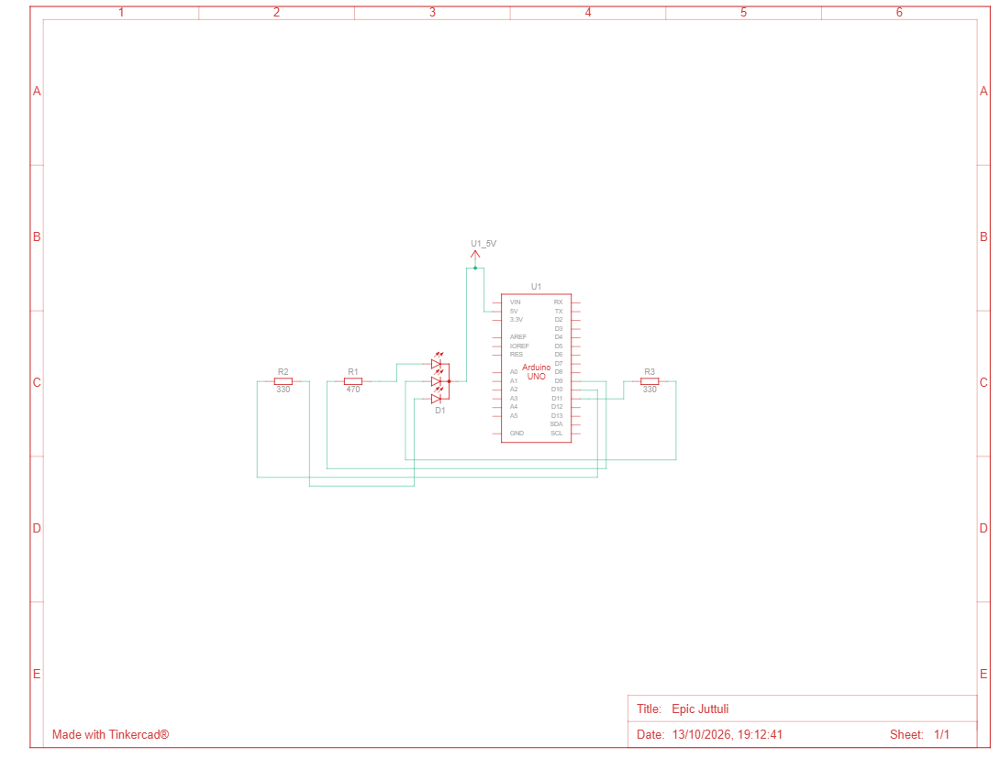

# Ejercicio 3 - Interfaz de usuario

**Alumnos:** Jorge Martínez Díaz y David Valiño Iglesias.
**Fecha:** 07/10/2026

En este ejercicio hemos modificado el programa para poder controlar el LED RGB desde el Monitor Serie de Arduino.  
El usuario introduce una cadena de tres valores, por ejemplo *101*, donde cada posición representa un color:  
* Primer valor → rojo
* Segundo valor → verde
* Tercer valor → azul  
El valor *1* enciende el color y el valor *0* lo apaga. Por ejemplo, *101* enciende el rojo y el azul, obteniendo magenta.  
El programa permanece esperando nuevos comandos para poder cambiar el color cuando el usuario quiera.

## Particularidades:  

La mayor dificultad encontrada ha sido plantear correctamente el loop, al principio nos daba algunos fallos que finalmente hemos sabido resolver. Este ejercicio era el de mayor dificultad y era una mezcla entre los dos anteriores.  

## Esquemático:  

## Enlace video:  

https://youtube.com/shorts/N9fSWncnbU8?feature=share
