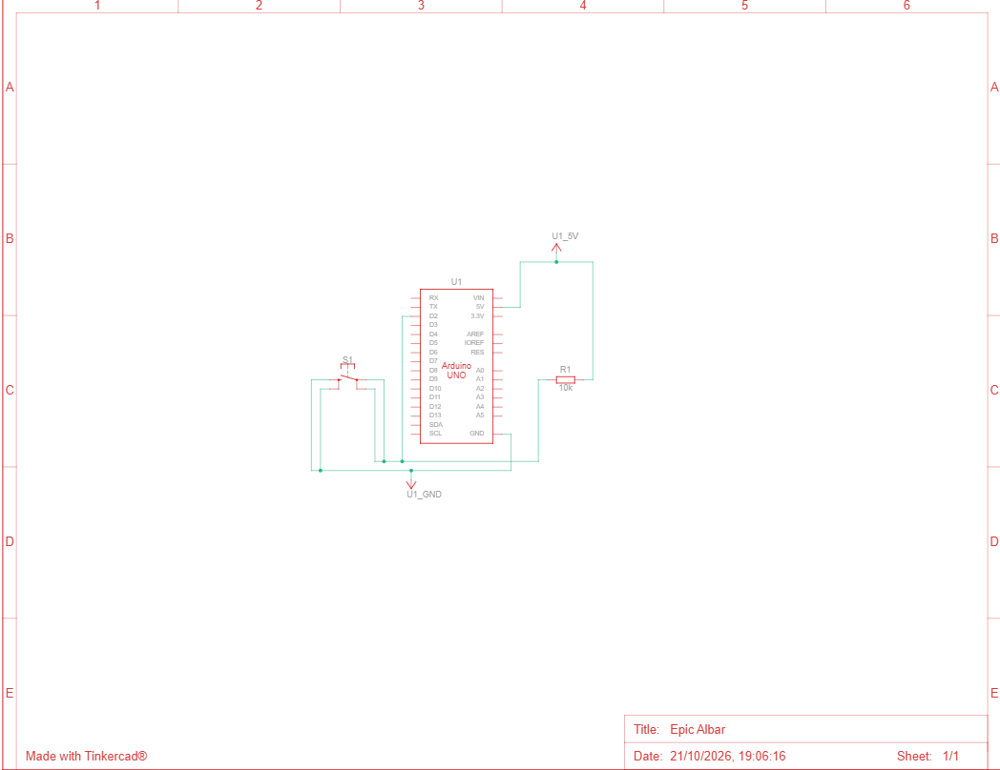
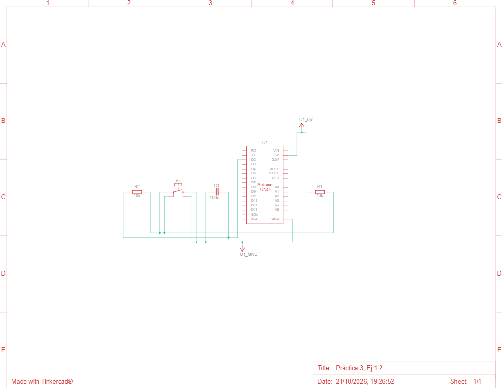

# Ejercicio 1 - Interrupciones y antirrebotes.

**Alumnos:** Jorge Martínez Díaz y David Valiño Iglesias.  
**Fecha:** 21/10/2026

En este ejercicio hemos modificado el programa de lectura de un pulsador mediante interrupciones para incorporar un filtro antirrebotes por software. El objetivo es evitar que los rebotes mecánicos del botón se cuenten como varias pulsaciones.  

El ejercicio consta de dos partes:
* **Circuito simple:** conectamos el pulsador al pin D2 con una resistencia pull-up externa de 10 kΩ. Al pulsarlo, la entrada pasa de HIGH a LOW y se genera una interrupción. El programa cuenta la pulsación y descarta nuevas interrupciones durante los siguientes 50 ms.
* **Circuito con condensador:** añadimos una resistencia un condensador para incorporar el filtrado RC por hardware.  

**En ambas partes utilizamos el mismo código: *boton_interrupcion_antirrebotes.ino*. Solo cambia el montaje del circuito.** El contador se muestra en el *Monitor Serie*.  

## Particularidades:

El condensador puede reducir los rebotes que llegan al pin, pero no garantiza eliminarlos por completo. Si el filtro software ya los descarta, el contador puede comportarse igual en ambos montajes. Por ello, mantenemos el antirrebote software también en la segunda parte.  

## Esquemático:

**Parte 1: circuito simple.**

**Parte 2: circuito con condensador.**

## Enlace videos:

**Enlace 1: circuito simple:** https://youtube.com/shorts/0VoLeQfq1vk  
**Enlace 2: circuito con condensador:** https://youtube.com/shorts/Bnj1h6_NFb0?feature=share