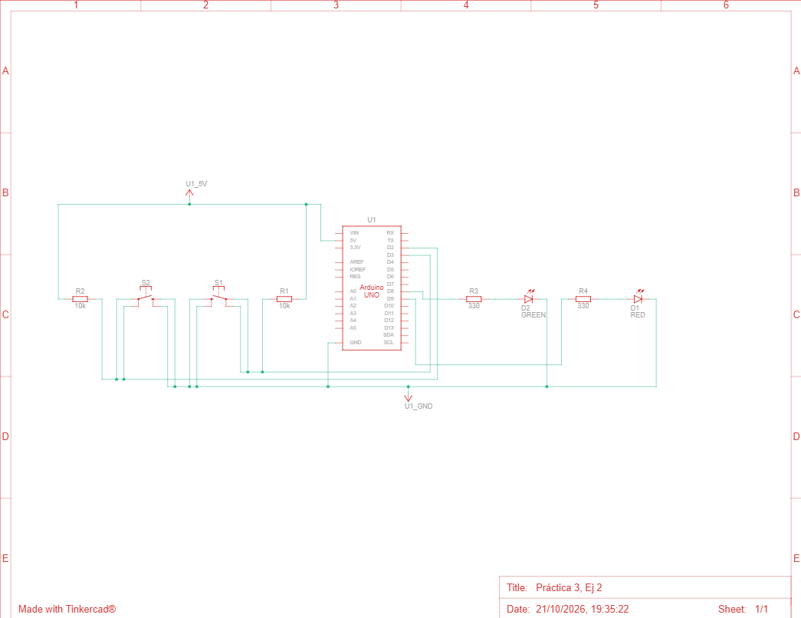

# Ejercicio 2 - Control de dos LEDs mediante interrupciones

**Alumnos:** Jorge Martínez Díaz y David Valiño Iglesias.  
**Fecha:** 21/10/2026

En este ejercicio hemos diseñado un circuito con dos pulsadores que controlan dos LEDs de forma independiente. El objetivo es utilizar interrupciones y antirrebote para obtener dos comportamientos diferentes:
* **Botón 1, conectado a D2:** enciende el LED 1, conectado a D8, mientras se mantiene pulsado. Al soltarlo, el LED se apaga.
* **Botón 2, conectado a D3:** cambia el estado del LED 2, conectado a D9, con cada pulsación. Una pulsación lo enciende y la siguiente lo apaga.

Cada pulsador lleva una resistencia pull-up externa de 10 kΩ y cada LED una resistencia de 330 Ω en serie. Utilizamos el programa `dos_botones_leds.ino`, con interrupciones CHANGE para detectar tanto la pulsación como la liberación de los botones.

El antirrebote se realiza por software: cada entrada se acepta cuando han transcurrido 40 ms sin nuevos cambios. Cada botón dispone de su propio temporizador, por lo que ambos funcionan de forma independiente.

## Particularidades:

El circuito funciona en Tinkercad. Sin embargo, al montarlo físicamente, el primer LED permanecía encendido y el segundo no se encendía. La causa todavía está pendiente de confirmar; es necesario revisar las conexiones de los pulsadores, las resistencias, la polaridad de los LEDs y la masa común.

El segundo LED solo cambia al detectar una pulsación válida; soltar el botón no modifica su estado. No utilizamos delay en el bucle principal, para poder validar los dos botones sin introducir esperas que retrasen su respuesta.

## Esquemático:

<!-- Guarda la captura del montaje con este nombre junto al README. -->

## Enlace video:

**Enlace circuito:** https://youtu.be/cvHOYjeGSRU